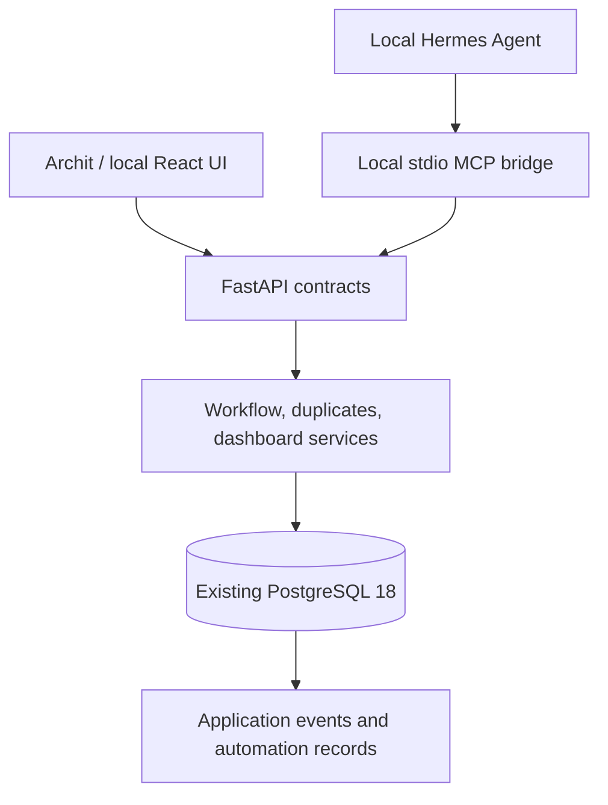

# Architecture

Job Application OS is the deterministic system of record. Hermes operates it through MCP and HTTP; it must never substitute LLM memory for stored history.

## Boundaries

- React + TypeScript + Vite + Tailwind in `frontend/`: local UI, paginated API reads,
  accessible forms, manual profile selection, drafts, activity and settings.
- FastAPI request/response schemas reject unknown fields and validate UUIDs,
  controlled values, email, URLs and timezone-aware dates. No ORM objects are
  serialized without a response schema.
- Services implement normalization, check-and-write duplicate protection,
  approval transitions and reporting. Simple list queries remain in the route
  module; no empty repository interfaces or agent abstractions are introduced.
- SQLAlchemy sessions are request scoped. Mutations and their events commit in
  one transaction. Closing a failed session rolls back unfinished work.
- PostgreSQL owns UUID generation, foreign keys, controlled-value constraints,
  JSONB state, timestamps and indexes. Triggers maintain updated timestamps for
  SQL as well as ORM writes. Alembic is the sole schema authority.

## Database continuity

The existing PostgreSQL installation on localhost:5432 hosts `job_application_os`
under its own login role. No Docker, new server, or workspace-local database is
needed. Other projects' databases and roles are untouched. Migration `0001` is
preserved. Migration `0002` extends it and backfills any legacy application rows
without deleting them or merging companies solely because normalized names match.
Migration `0003` adds reporting indexes and a trigger preventing updates/deletion
of application events. Existing company/role/source snapshot fields are retained. `applied_at` in the API
maps to the original `date_applied` database column.

The old `.local` directory, if present from the first setup, is not used. Its
stopped database files have not been deleted. The obsolete start script and
workspace-cluster provisioning option have been removed. `.cache` holds only
ignored tool/test caches. Application data stays in the existing server.

## Duplicate decisions

Company normalization applies Unicode NFKC, case folding, punctuation/whitespace
cleanup and removal of trailing legal suffixes. Role normalization retains
seniority and language symbols such as C++ and C#. Non-unique name indexes find
candidates; they never force companies or applications to merge.

Job URLs normalize scheme/host, trailing slashes, fragments and known tracking
parameters. Meaningful query parameters and path case survive. Exact job URLs,
application URLs, the same lead, or a source-scoped external job ID produce strong
matches. Equal normalized company and role without distinct job identifiers
produce an explainable review match. Different explicit job IDs/URLs allow
separate openings with identical titles. Recruiter email and source post URL are
supporting signals, not unique job identities. Similar roles are suggestions,
not automatically duplicates. API documentation describes the response.

Creation and identity updates acquire a transaction-level PostgreSQL advisory
lock before querying candidates. This intentionally serializes application
writes in this personal system and prevents check-then-insert races across API
workers. Queries stream candidate batches rather than loading the whole table.
A user can override an ambiguous match with an explanation of at least 10
characters; the explanation is audited. Strong matches cannot be overridden.

## Approvals and local access

Drafts move through draft → reviewed → approved → sent (a manual record only).
Changing reviewed or approved content resets it to draft and clears approval.
Sent drafts are immutable through the API. Future integrations must implement
actual sending separately; no network side effect exists here. Only the `user`
actor can approve or record external submission outcomes in this phase.

`X-Actor` labels provenance; it is **not authentication**. The app is intentionally
local-only. Bind both servers to 127.0.0.1. Trusted host checking and explicit CORS
origins reduce accidental exposure but do not replace authentication. Future
Hermes access needs authenticated identities, scoped permissions and idempotent
external actions before this boundary can be trusted remotely.

Errors have an `error` envelope. Validation output excludes raw input values.
Database errors and parameters are not returned or logged; logs include only
method, route and exception class. Do not store tokens, passwords or cookies in
notes, metadata, drafts or automation input/output.

## Implemented MCP boundary

`backend/mcp/server.py` runs as a separate stdio process using official MCP SDK
2.0.0, matching the installed Hermes client. It exposes 25 typed business tools
and talks exclusively to the loopback FastAPI origin over HTTP. It does not load
`.env`, DATABASE_URL, SQLAlchemy, ORM models or the session layer. Shared enum
values were extracted into `app/core/enums.py` so public Pydantic contracts are
usable without importing persistence. No business rules were moved into MCP.

Small API additions support normalized company resolution and transactional lead
intake, name-based duplicate checking, contact retrieval and version-checked draft
approval. Name resolution refuses ambiguous records instead of guessing a merge.
The existing save_lead, duplicate and draft services perform all state changes.
Those original MCP helpers required no migration or frontend change.

Ordinary MCP mutations are labeled hermes. Email approval uses MCP elicitation to
obtain user consent before calling the user-only approval route. That route checks
the shown updated_at under a row lock, rejects stale content, and records approval
without sending. Re-labeling an explicit event as user/system likewise asks for
confirmation. The local client's confirmation channel is trusted; it does not
replace future authenticated identities.

Read tools are annotated read-only. No generic SQL/HTTP/shell/file tools are
registered. External origins, URL credentials, HTTP redirects and environment
proxies are refused. Timeouts produce an uncertain-write warning rather than an
automatic write retry. Stdout carries only protocol messages; no Hermes file is
modified. See [exact setup and tool catalog](hermes-mcp-setup.md).

## Lead Hunter

The first Hermes workflow lives in `.hermes/skills/lead-hunter/`. Hermes supplies
public research through MCP; `/lead-hunter/context` and `/lead-hunter/research`
keep profile reads, normalization, explainable scoring and lead/application
deduplication inside the API. No research code fetches external URLs. Migration
0004 adds structured lead evidence and indexed URL identities. New leads and
append-only research events are committed with their AutomationRun in one
transaction. The existing frontend displays these leads and evidence unchanged.
See [Lead Hunter](lead-hunter.md) for contracts, limits and trust setup.
